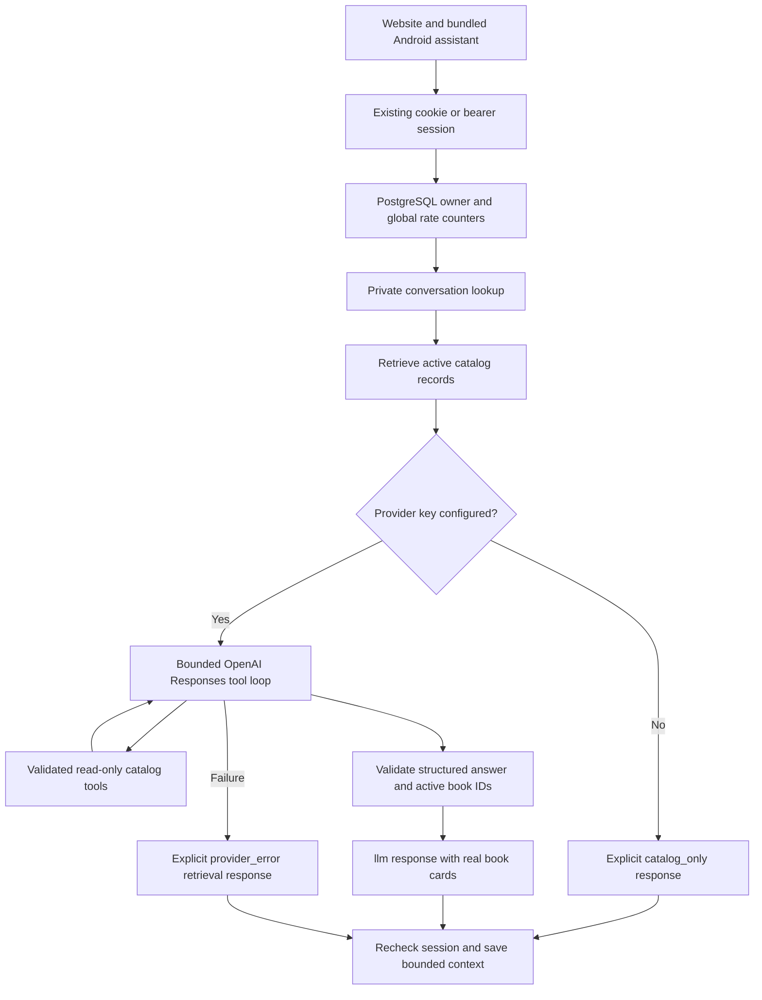

# Embedded catalog assistant architecture

Updated November 4, 2026 (Asia/Manila).

The shared React assistant is implemented at `/app/assistant` on the website and in the
Capacitor Android application. Both clients use the same authenticated FastAPI routes and
PostgreSQL catalog. The backend supports OpenAI-generated answers and explicitly labeled
catalog retrieval. **No-key retrieval is not an operational LLM.** Live generation remains
blocked/unverified until a backend key is configured and real requests pass.

## Request path



`backend/app/api/assistant.py` exposes authenticated `GET /api/v1/assistant/status` and
`POST /api/v1/assistant/chat`. Chat validates a trimmed message of 1–1,000 characters and an
optional conversation UUID, then calls `app.services.assistant.chat`. Extra fields are rejected.
Clients cannot supply user identity, roles, SQL, provider URLs, or executable tool definitions.

## Real catalog retrieval and response modes

The service queries `Book` before generation. Retrieval combines language/category recognition,
title/author/description evidence, subject synonyms, beginner ranking, free/paid filters, and
prior conversation references. Queries are parameterized and bounded. Only active records are
eligible; returned `BookOutput` cards link to actual `/app/books/{id}` routes.

Follow-ups such as “only the free ones,” “something similar,” or “tell me about the first one”
use prior query/result IDs. Referenced records are checked against the current database, so
archived books do not remain eligible merely because an earlier message included them.
No-result searches return an explicit missing-match answer rather than fabricated books.

| `mode` | Meaning |
| --- | --- |
| `catalog_only` | Database retrieval; no LLM generation occurred. The answer discloses the missing provider configuration. |
| `llm` | A provider response passed structured validation and current catalog-ID checks. |
| `provider_error` | Generation failed or returned unusable output; the answer explicitly falls back to catalog retrieval. |

The status endpoint reports configuration, not working billing, model access, or provider health.
The chat response sets `generation_available: true` only for an accepted `llm` result. Model
instructions require grounded prose, but live answer quality must still be evaluated; valid
database IDs alone do not establish the quality of every generated explanation.

## Provider and tools

The implementation uses Python's standard-library HTTPS client, preserving the current WASIX
dependency profile. The endpoint is fixed at `https://api.openai.com/v1/responses`. The configurable
default model is `gpt-5-mini`. The integration follows the
[OpenAI Responses function-calling interface](https://developers.openai.com/api/docs/guides/function-calling)
and [GPT-5 mini model documentation](https://developers.openai.com/api/docs/models/gpt-5-mini),
checked November 4, 2026.

Two read-only tools are implemented:

| Tool | Validated input | Operation |
| --- | --- | --- |
| `search_books` | Query up to 150 characters, optional category up to 80 characters, limit 1–8 | Searches current active PostgreSQL records |
| `get_book_details` | Book UUID | Reads one active record or returns no match |

Function schemas reject extra arguments. The server allows only those names and validates
arguments again before SQL execution. The assistant cannot save books, consume tracking
allowance, modify accounts, administer books, or claim file delivery. Favorites and tracking
remain separate, explicitly authorized application actions.

The loop permits at most four provider rounds and checks a 45-second budget before each round.
Each HTTP timeout is at most 20 seconds or the remaining budget. Responses are capped at 1 MiB;
each request asks for at most 1,200 output tokens. Tool calls/results are bounded. The structured
answer permits at most eight book IDs; malformed, unknown, or ineligible IDs reject the generated
result. Eligibility is checked against active database rows before returning recommendation cards.
Provider exception details, response bodies, keys, and headers are not logged or shown to users.

Requests use `store: false`. Only public catalog metadata and bounded conversation text go to
the provider. Passwords, hashes, session tokens, database credentials, and unnecessary account
details are excluded. User messages and catalog descriptions are untrusted data, not authority
to override instructions or tools. The UI renders answer text; navigation uses database-backed
cards rather than model-supplied URLs.

## Private conversation state

Migration `0003` adds `assistant_conversations`. A database constraint binds each row to exactly
one registered user or guest session. Supplied conversation IDs are queried under the authenticated
owner; another owner's ID returns 404. Registered ownership spans web/native sessions; guest
ownership stays specific to its existing guest session.

The server retains the last twelve history records. Provider input uses a bounded subset plus
the current message and catalog lookup. The frontend holds the current conversation ID while
the chat is open. This is not a cross-device conversation browser or automatic chat restoration
feature; continuation requires the conversation ID and correct authenticated owner.

The session is rechecked before history is committed, so expiry/logout during a request cannot
authorize saving its answer. PostgreSQL context and counters are shared across deployed workers;
they do not depend on a particular process staying alive.

## Rate limits and secrets

`assistant_rate_limits` stores atomic one-hour counters for each owner and the whole backend.
Registered sessions share an account counter; guest sessions have their own counter. The global
counter bounds aggregate usage even when new guest sessions exist. Retrieval and generation
both consume request allowance; failures can count too. A denied request returns 429 and a retry
header. Default limits are 20 requests per owner and 100 globally per window.

Backend-only configuration:

```dotenv
OPENAI_API_KEY=
OPENAI_MODEL=gpt-5-mini
ASSISTANT_REQUESTS_PER_HOUR=20
ASSISTANT_GLOBAL_REQUESTS_PER_HOUR=100
```

Set real values privately in `backend/.env` for development and deployed secrets or the ignored
`.env.production` for Wasmer. Restart/redeploy after configuration changes. Never put a key in
`VITE_*`, JavaScript, Android resources, Git, or documentation. An empty key intentionally blocks
generation while database retrieval remains usable. Installing this integration does not imply
a paid provider request occurred or that model access is functional.

## Interface and evidence

The shared interface provides navigation access, suggested questions, separate user/assistant
messages, loading, retry, new-conversation controls, and actual recommendation cards. The same
responsive UI is bundled into Android. Retrieval-only/provider-error notices remain visible so
the demonstration cannot be mistaken for functioning LLM generation.

Backend tests exercise real PostgreSQL retrieval, archive visibility, owner isolation, follow-ups,
validation, limits, and mocked provider paths. Mocked HTTP responses verify application control
flow, not a live OpenAI deployment. Browser and installed-APK checks require separate evidence.
Current results and blockers are recorded in [testing](testing.md) and the
[Phase 1 acceptance handoff](phase1-completion.md).
