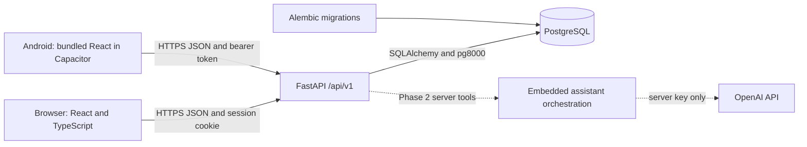

# Phase 1 architecture

E-Library AI has one frontend codebase and one backend. The browser runs React
assets served by Vite or a static host. Capacitor packages those same built assets
inside Android. Neither client connects directly to PostgreSQL.

## Boundaries and important files

`apps/web/src/lib/api.ts` owns the API base URL, cookies/bearer headers, errors,
and native HTTPS checks. All pages use it; Android has no separate business logic.
`AuthContext.tsx` restores web sessions, creates real user/guest sessions, tracks
expiration, ignores obsolete refresh responses, and clears state after logout.
`ProtectedRoute.tsx` handles navigation; backend session verification remains the
authorization boundary. `useCatalog.ts` provides cancellation, loading, and retry.

Backend routes live in `app/api/`. Pydantic schemas validate requests and reject
extra auth fields, including client-supplied roles. `app/services/auth.py` owns
Argon2id hashing, cryptographic session creation, profile lookup, and token hashing.
`app/core/config.py` rejects non-PostgreSQL URLs, wildcard CORS, and insecure
production cookie settings. `app/models/entities.py` owns persistence, while
`alembic/versions/0001_initial_library_foundation.py` records the initial schema.
Migrations run explicitly, never implicitly on each application startup.

The synchronous SQLAlchemy implementation is deliberately small. FastAPI runs sync
route handlers in its thread pool. `pg8000` provides a pure Python PostgreSQL driver,
reducing native deployment dependencies. PostgreSQL stores all accounts and sessions.
No SQLite implementation or mock authentication exists.

## Authentication and storage

Passwords use Argon2id with 64 MiB memory, three iterations, and parallelism four.
A random 32-byte URL-safe session token authenticates requests. The database stores
only its SHA-256 digest. User sessions default to seven days; guest sessions default
to one day. Every protected request checks database expiry and revocation.
Logout records `revoked_at`; replaying that token fails. Sign-in/registration rotates
the current session, including a guest session, without changing other devices.

Browsers receive an HttpOnly cookie with `/api/v1` scope. JavaScript never receives
the web token. Use Secure cookies in production and exact trusted CORS origins.
Mutation requests from untrusted origins are rejected before routing; cookie-based
mutations require an Origin header. Cross-site deployments need `SameSite=None`
and HTTPS, and may still encounter third-party cookie blocking. Same-site custom
domains are preferable. Development defaults work when both addresses use 127.0.0.1.

Android requests `client: "android"` and keeps its bearer token only in memory.
App restart therefore requires sign-in again. Tokens are never placed in
localStorage, sessionStorage, Capacitor Preferences, URLs, or logs. A future persistent
native session must use an audited Android Keystore-backed storage implementation.
Theme preference alone is stored in localStorage. HttpOnly and memory storage reduce
token exposure but do not eliminate the impact of malicious scripts; review third-party
code and deploy an appropriate Content Security Policy before public release.

Auth responses disable caching. SQLAlchemy failures return a generic 503 without
query parameters or credentials. Public catalog endpoints intentionally allow the
welcome page to load book previews. No private library data is exposed through them.
Public rollout should add shared rate limiting, account recovery/verification, and
operational monitoring; those are not implemented Phase 1 claims.

## Interface and extension points

The interface uses local system typography, original CSS book-cover placeholders,
teal accents, semantic forms, visible focus states, loading skeletons, and reduced
motion. Desktop has a sidebar; mobile has bottom navigation and safe-area padding.
Light/dark themes use shared CSS variables. There are eight seeded books, four
categories, server search/filtering, and bounded pagination ready for a larger catalog.

My Library, Favorites, downloads, and the embedded assistant are explicit Phase 2
empty/preview states. No fake chat messages, successful saves, download counters,
or claim of a complete 200-book catalog appears in the application.
