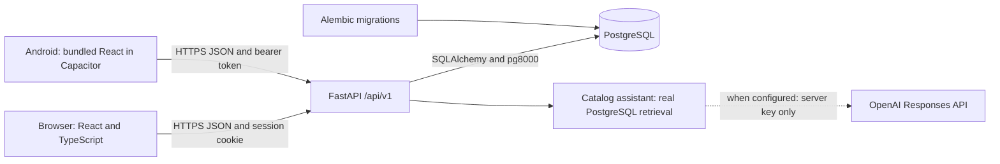

# Phase 1 architecture

E-Library AI has one frontend codebase and one backend. The browser runs React
assets served by Vite or a static host. Capacitor packages those same built assets
inside Android. Neither client connects directly to PostgreSQL.

## Boundaries and important files

`apps/web/src/lib/api.ts` owns the API base URL, cookies/bearer headers, errors,
and native HTTPS checks. All pages use it; Android has no separate business logic.
`AuthContext.tsx` restores web cookies or saved native sessions, creates real user/guest sessions, tracks
expiration, ignores obsolete refresh responses, and clears state after logout.
`ProtectedRoute.tsx` handles navigation; backend session verification remains the
authorization boundary. `useCatalog.ts` provides cancellation, loading, and retry.

Backend routes live in `app/api/`. Pydantic schemas validate requests and reject
extra auth fields, including client-supplied roles. `app/services/auth.py` owns
Argon2id hashing, cryptographic session creation, profile lookup, and token hashing.
`app/core/config.py` rejects non-PostgreSQL URLs, wildcard CORS, and insecure
production cookie settings. `app/models/entities.py` owns persistence, while
`alembic/versions/0001_initial_library_foundation.py` records the initial schema.
Migrations run explicitly, never implicitly on each application startup.

The Phase 1 extension adds role-protected `app/api/admin.py`, the shared
`app/api/assistant.py` endpoint, two read-only catalog tools, private bounded
conversation context, and PostgreSQL rate limits. Migration `0003` preserves
administrator catalog edits across seed runs and adds assistant state. See the
[implementation handoff](phase1-completion.md) and [AI architecture](ai-architecture.md).
Catalog-only retrieval is explicitly distinguished from configured/live LLM generation.

The synchronous SQLAlchemy implementation is deliberately small. FastAPI runs sync
route handlers in its thread pool. `pg8000` provides a pure Python PostgreSQL driver,
reducing native deployment dependencies. PostgreSQL stores all accounts and sessions.
No SQLite implementation or mock authentication exists.

## Authentication and storage

Passwords use Argon2id with 64 MiB memory, three iterations, and parallelism one for WASIX compatibility.
A random 32-byte URL-safe session token authenticates requests. The database stores
only its digest. Configured sessions use environment-keyed HMAC-SHA256 and a `v1.`
token prefix; legacy unprefixed SHA-256 sessions remain valid until expiry/revocation.
Production requires a backend-only `SESSION_TOKEN_SECRET`. User sessions default to seven days; guest sessions default
to one day. Every protected request checks database expiry and revocation.
Logout records `revoked_at`; replaying that token fails. Sign-in/registration rotates
the current session, including a guest session, without changing other devices.

Browsers receive an HttpOnly cookie with `/api/v1` scope. JavaScript never receives
the web token. Use Secure cookies in production and exact trusted CORS origins.
Mutation requests from untrusted origins are rejected before routing; cookie-based
mutations require an Origin header. Cross-site deployments need `SameSite=None`
and HTTPS, and may still encounter third-party cookie blocking. Same-site custom
domains are preferable. Development defaults work when both addresses use 127.0.0.1.

Android requests `client: "android"`. `NativeSessionPlugin.java` encrypts its bearer
token using AES-256-GCM and an Android Keystore key. The ciphertext lives in an
app-private, backup-excluded file; the API base URL is authenticated with the
ciphertext so a credential is not restored for a different backend. Atomic writes
and serialized bridge operations prevent a pending save from undoing logout.
Startup restores the token before `/auth/me`, and a valid session opens the native
dashboard directly. Network failures retain the saved credential for retry. Logout,
expiry, and a current-session 401 clear it; invalid ciphertext or an unavailable
key require sign-in again. Server expiry/revocation remains authoritative.
Tokens and passwords are never placed in localStorage, sessionStorage, Capacitor
Preferences, URLs, or logs. Android bridge logging is disabled to avoid logging
plugin arguments. Theme preference alone is stored in localStorage. These controls reduce
token exposure but do not eliminate the impact of malicious scripts; review third-party
code and deploy an appropriate Content Security Policy before public release.

Auth responses disable caching. SQLAlchemy failures return a generic 503 without
query parameters or credentials. Public catalog endpoints intentionally allow the
welcome page to load book previews. No private library data is exposed through them.
Public rollout should add shared rate limiting, account recovery/verification, and
operational monitoring; those are not implemented Phase 1 claims.

## Interface and extension points

The interface uses local system typography, original CSS book-cover placeholders,
teal accents, semantic forms, visible focus states, loading skeletons, and reduced
motion. Desktop has a sidebar; mobile has bottom navigation and safe-area padding.
Light/dark themes use shared CSS variables. The shared catalog contains 200 active
programming books, including 60 Rust titles, with server search/filtering and bounded
pagination. Administrator additions, edits, archives, and restores appear after refresh.

My Library displays private tracking history and the current allowance. Favorites
supports registered-account saves and removal. Free-book details expose an explicitly
labeled tracking demonstration; actual book-file delivery is not implemented. The
assistant displays real catalog results, contextual follow-ups, and clickable book cards.
OpenAI generation remains blocked while its server-side key is unset; the interface
identifies catalog-only retrieval honestly.

`services/library.py` derives ownership from verified
sessions and serializes writes using PostgreSQL session/account row locks. Every device
shares an account's ten-book quota; each guest session has five slots. Expiry is checked
after lock waits. Future agent tools can reuse these services without separate quota logic.
