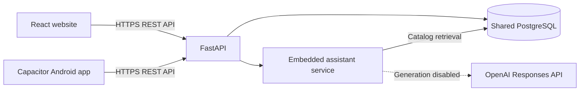

# E-Library AI by shio del rio — Phase 2 Presentation

Prepared: November 21, 2026 (Asia/Manila).
Course: IPT102 — Integrative Programming and Emerging Technologies 2.
Presenter: shio del rio.

**Required length: exactly 5 slides, or 5 presentation pages.**
This outline follows Section V of the supplied official examination document for
the November 21 Development Progress Presentation. The live demonstration is also
required; it does not add slides. Include your name and project title on Slide 1
instead of adding a separate cover, references, or thank-you slide.

Copy each section's **On-slide content** into its slide. Put the speaker notes and
demo instructions in presenter notes. The Markdown file itself is a preparation
guide, not the required PowerPoint submission.

| Slide | Official title | Main purpose |
| --- | --- | --- |
| 1 | Development Progress | Explain completed work, pending requirements, and current status |
| 2 | Android Application | Show mobile screens and demonstrate working features |
| 3 | Web Application | Show the website, administrator tools, and catalog |
| 4 | Backend and AI Integration | Explain the shared database, REST API, assistant, and tools |
| 5 | Testing and Final Development Plan | Present evidence, known issues, repository, and December 5 plan |

## Slide 1 — Development Progress

### On-slide content

**E-Library AI by shio del rio**
An integrated programming library for web and Android.

- **Goal:** help students and programmers discover books through one shared system.
- **Catalog:** 200 unique programming titles, including 60 Rust books.
- **Working:** registration, login/logout, guest access, search, categories, book details,
  favorites, initial My Library tracking, and website book management.
- **Integration:** both clients use the same FastAPI backend and PostgreSQL database.
- **Status:** Phase 1 functional foundation is met. Phase 2 is substantially implemented;
  live AI-led tool execution remains unverified.
- **Pending final work:** authorized file delivery, complete agent actions, and final acceptance evidence.

### Visual to include

Use the project logo with one small website screenshot and one Android screenshot.
Keep the project title and your name on this slide.

### Speaker notes

“E-Library AI is a programming-focused digital library available through a website
and an Android application. Both platforms share accounts, catalog records, and
library data through one backend. The collection contains 200 titles, with Rust as
the largest category. The current build covers the foundation and most functional
modules. I will distinguish working catalog retrieval and download tracking from
the remaining generated AI and file-delivery features.”

**Catalog detail if asked:** 34 titles have free online editions; 166 are paid
publisher listings. These are 200 catalog entries, not 200 freely downloadable files.
Confirm the instructor's interpretation of accessible books when discussing paid listings.

## Slide 2 — Android Application

### On-slide content

- **Implementation:** React, TypeScript, and Vite packaged as an Android app with Capacitor.
- **Access:** registration, login, logout, and separate guest sessions.
- **Discovery:** shared catalog, title/author search, category filters, and book details.
- **Personal features:** registered-user favorites and account-linked tracking history.
- **Assistant:** embedded catalog-backed chat with clickable book results.
- **Session storage:** Android Keystore protects the saved sign-in credential.

### Screenshots to include

Use two or three readable screenshots from the current APK:

1. Dashboard or catalog with Rust books.
2. Book details showing source and access information.
3. Favorites or the embedded assistant's labeled catalog-retrieval response.

### Live demonstration

1. Open the installed application on the Samsung A55.
2. Sign in with a demonstration account, or show an already restored session.
3. Search for a Rust title and apply the Rust category filter.
4. Open a result and show its author, description, access label, and official source.
5. Save a favorite and open Favorites.
6. Open the assistant and ask: **“Find beginner Rust books.”** Explain its current retrieval mode.
7. Show guest access separately if time permits; do not imply that guests have registered-user favorites.

### Speaker notes

“The Android application reuses the same React screens and REST API as the website.
The phone does not connect directly to PostgreSQL. Registered users can keep their
favorites across platforms. The native sign-in credential is encrypted using Android
Keystore. The assistant is embedded in the application and retrieves real catalog
records. Its current response does not claim that a live language model generated it.”

**Samsung A55 result — owner-reported, November 21:** the loading screen now covers
the whole display. This confirms the startup layout fix on the physical phone,
alongside the emulator checks in both themes. This report covers the loading layout;
it does not establish a fresh pass for every other application flow.

## Slide 3 — Web Application

### On-slide content

- **Website:** https://elibrary-ai.wasmer.app
- **Reader features:** authentication, guest access, catalog search/filtering, details, and favorites.
- **Shared data:** the same registered account accesses its favorites and tracking records on Android.
- **Administrator dashboard:** database-backed counts and recent activity.
- **Book management:** add, edit, archive, and restore catalog records.
- **Interface:** responsive navigation, light/dark themes, and an embedded catalog assistant.

### Screenshots to include

Use a website catalog screenshot and an administrator book-management screenshot.
Keep titles and controls readable instead of shrinking the whole site onto the slide.

### Live demonstration

1. Open the deployed website and sign into the same demonstration account used on Android.
2. Refresh Favorites and show the book saved on the phone.
3. Search by title or author, then show a category filter and book details.
4. Use an administrator session to show dashboard counts and the book editor.
5. Demonstrate editing or archive/restore with a prepared demonstration record.
6. Show that normal readers and guests do not receive administrator access.

### Speaker notes

“The website uses the same backend and database as Android. A favorite saved on the
phone appears on the website after refresh because it belongs to the same account.
Administrators can manage catalog records through protected endpoints. Archiving
removes a book from the public catalog while preserving its existing history.
Authorization is enforced on the backend.”

## Slide 4 — Backend and AI Integration

### On-slide content

- **Backend:** Python FastAPI with SQLAlchemy and Alembic migrations.
- **Shared PostgreSQL data:** users, sessions, books, favorites, downloads,
  assistant conversations, and assistant rate limits.
- **REST API:** authentication, catalog, favorites, tracking, administration, and assistant routes.
- **Security:** Argon2id password hashes, secure HttpOnly browser cookies,
  native bearer sessions, ownership checks, and backend-only secrets.
- **Tracking limits:** 5 distinct books per guest session; 10 per registered account across devices.
- **Assistant status:** real catalog retrieval works. OpenAI Responses integration
  and read-only tools exist; live generation remains disabled and unverified.

### Architecture visual

Convert this diagram into a simple slide graphic, or use it in a Markdown viewer
that supports Mermaid:

### API and tool examples for explanation

All routes below use the `/api/v1` prefix:

| Example | Purpose |
| --- | --- |
| `GET /auth/me` | Validate the current guest or registered session |
| `GET /books?q=rust&category=Rust` | Search the actual catalog |
| `POST /favorites` | Save a favorite for the authenticated registered user |
| `POST /downloads` | Record a tracking demonstration and enforce the current allowance |
| `POST /assistant/chat` | Retrieve catalog-backed conversation results |
| `search_books` / `get_book_details` | Implemented read-only tools available to the provider integration |

### Demonstration and speaker notes

Show an assistant query returning real catalog cards, then open one card's book
details. If useful, show a sanitized chat response identifying `mode: "catalog_only"`.
Use [AI architecture](ai-architecture.md) to explain the tool definitions and request flow.

“The backend validates the session, checks permissions, and reads the shared database.
Book limits are enforced inside database transactions. The existing download action
records a tracking event; it does not deliver a book file. The assistant retrieves
actual book records and links to their details. Its provider integration supports
search and detail tools, but generation is currently disabled. I am not claiming
that this demonstration proves live AI-led tool execution.”

**Open Phase 2 evidence:** the rubric asks for initial AI integration and tool
execution. Catalog retrieval and tool source code do not establish a successful
live provider-driven tool run. Mark that demonstration as pending.

## Slide 5 — Testing and Final Development Plan

### On-slide content

- **Recorded automated results:** 91 backend tests, 34 frontend tests,
  17 browser end-to-end tests, and 3 cross-site cookie tests passed.
- **Latest Android layout check:** 8 browser size/theme combinations and native
  emulator startup checks passed; production build and APK signature verification passed.
- **Issue addressed:** startup loader filled only half the screen. The owner confirmed
  full-screen loading on the Samsung A55; emulator checks passed in both themes.
- **Remaining checks:** live AI tool execution, actual authorized file delivery, and broader final acceptance.
- **Before December 5:** complete agent actions, legal downloads with limits, and final integration/submission evidence.
- **Repository:** https://github.com/shiodr/E-Library-AI_DelRio

### Testing evidence to show

| Evidence | What it establishes | Date or scope |
| --- | --- | --- |
| Backend: 91 passed | Authentication, authorization, catalog, quotas, ownership, migrations, and assistant control flow | November 20 audit; provider paths use mocks |
| Frontend: 34 passed | Existing UI and session regression tests | Rerun November 21 for the startup fix |
| Browser: 17 passed | Local integrated reader/admin/catalog flows | November 20; 1 duplicate viewport test intentionally skipped |
| Cross-site cookies: 3 passed | Browser authentication with ordinary third-party cookies blocked | November 20 local HTTPS tests |
| Startup: 8 browser combinations | Full-height, centered loading layout and sign-in transition | November 21; 4 sizes in each theme |
| Android emulator and APK checks | Native loading layout in both themes; APK builds and signature verifies | November 21 |
| Physical Samsung A55 | Loading screen covers the whole display | Owner-reported success, November 21; startup layout only |

The first four counts are separate suites, not one new combined test run. Use
dated output from the [audit](phase1-phase2-audit.md) and the latest local check logs.
Automated tests with mocked provider responses do not prove live OpenAI success.

### Final development plan

1. Include the confirmed Samsung A55 startup layout result in the demonstration.
   Complete final acceptance evidence for session restoration, navigation, keyboard,
   and shared-account behavior separately.
2. When the owner enables the provider, verify real generated responses and tool
   execution on both platforms. Generation remains blocked under the current preference.
3. Complete final agent requirements: contextual comparison/recommendation, confirmation
   before saving to My Library, and at least two connected real tool calls.
4. Implement legally authorized file delivery and verify the 5/10 limits on actual
   download access. Paid publisher links must retain their purchase/access labels.
5. Complete Docker runtime, CI, security, and integrated acceptance evidence.
6. Prepare final technical documentation as PDF, the exact five-slide final deck,
   installable APK, website URL, GitHub source, and live demonstrations for December 5.

### Speaker notes and submission reminder

“The results show that the shared foundation and most functional modules have
automated evidence. The latest Android startup layout passed browser and native
emulator checks, and I confirmed full-screen loading on my Samsung A55. Before the final
presentation, the main work is real AI tool execution, confirmed library actions,
authorized file delivery, and complete deployment and submission evidence.”

For the **Phase 2 submission**, prepare the five-slide PowerPoint using this outline,
updated Android APK, working website URL, updated GitHub repository, updated technical
documentation, and a live demonstration of completed modules.

Preparation limit: this file supplies presentation content and demo guidance; it does
not create a PowerPoint or prove submission/presentation completion. Live AI generation
remains unverified; the new physical-phone result confirms startup layout specifically.
